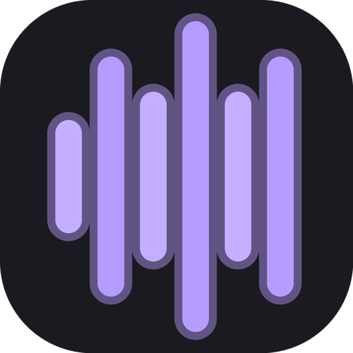

  

<h1 align="center">DJSync — export USB Rekordbox gratuit pour platines Pioneer, sans Rekordbox</h1>

  Trouvez de la musique et mettez-la sur votre clé USB Rekordbox, prête pour les CDJ Pioneer, sans passer par Rekordbox. 
  Un seul fichier sur la clé, n'importe quel ordinateur : Windows, macOS, Linux. 
  <a href="README.md">English version</a> · <a href="https://pikkol0.github.io/djsync/">Site</a> ·
  <a href="https://github.com/Pikkol0/djsync/releases/latest">Télécharger</a>

---

## Pourquoi DJSync ?

- **Comment mettre de la musique sur une clé USB sans Rekordbox ?** DJSync écrit lui-même la bibliothèque
  Rekordbox de la clé (`exportLibrary.db` pour les platines récentes, `export.pdb` pour les anciennes, formes
  d'onde ANLZ), depuis une application portable qui se lance directement depuis la clé.
- **Existe-t-il une alternative gratuite à Rekordbox pour CDJ / XDJ ?** Pour préparer une clé : oui. DJSync est
  gratuit et libre (GPL-3.0), sans compte, sans abonnement et sans serveur.
- **Comment mettre des sons YouTube ou SoundCloud dans Rekordbox ?** Cherchez ou collez un lien (YouTube,
  SoundCloud, playlists Spotify ou Deezer) : DJSync télécharge, renseigne les tags, analyse (BPM, tonalité,
  grille, cues) et ajoute les sons à la clé ou à la collection Rekordbox de l'ordinateur.
- **Peut-on analyser BPM, tonalité et grille sans Rekordbox ?** Oui, sur l'ordinateur, et on peut corriger la
  grille et poser hot cues, boucles et mémoires dans DJSync.

## Ce que fait DJSync

- **Chercher et télécharger** depuis YouTube Music, ou **importer un lien** Spotify, YouTube, SoundCloud ou
  Deezer (un son ou une playlist) ; sources de meilleure qualité (fichiers d'origine SoundCloud, Internet
  Archive, Audius, Soulseek en option).
- **Écrire directement dans la bibliothèque de la clé** (OneLibrary et `export.pdb`), ou dans la collection
  Rekordbox de l'ordinateur (`master.db`, Rekordbox 6 / 7, pendant que Rekordbox est fermé).
- **Analyser** les sons sans Rekordbox : BPM, grille, tonalité (Camelot), formes d'onde Pioneer.
- **Gérer la bibliothèque** : playlists et dossiers, glisser-déposer, ordre des sons, filtre harmonique,
  lecteur intégré, doublons, qualité supposée des fichiers, dossier surveillé pour vos achats.
- **Sauvegarder et restaurer** en un clic : l'état d'origine de la clé (avant DJSync) est gardé pour toujours.

Interface en anglais par défaut, traduction française complète (Paramètres ▸ Général).

> ⚠️ Projet personnel, sans lien avec Pioneer DJ / AlphaTheta. Les formats de la clé sont rétro-conçus :
> **gardez une copie de votre clé** et fermez Rekordbox pendant que DJSync écrit dessus.

## Télécharger

| Votre ordinateur | Téléchargement |
|---|---|
| **Windows** 10 / 11 | ⬇ [**DJSync.exe**](https://github.com/Pikkol0/djsync/releases/latest/download/DJSync.exe) — un seul fichier |
| **macOS** 11+ (Apple silicon) — *bêta* | ⬇ [**DJSync-macOS.dmg**](https://github.com/Pikkol0/djsync/releases/latest/download/DJSync-macOS.dmg) |
| **Linux** x86-64 — *bêta* | ⬇ [**DJSync-Linux-x86_64.tar.gz**](https://github.com/Pikkol0/djsync/releases/latest/download/DJSync-Linux-x86_64.tar.gz) |

Mettez-le sur la clé et ouvrez-le : rien à installer sur l'ordinateur, FFmpeg et le moteur JavaScript
nécessaire à YouTube sont inclus. Pas à pas : **[guide d'installation](docs/INSTALL.fr.md)** ·
**[guide du testeur](docs/TESTING.fr.md)** · [toutes les versions](https://github.com/Pikkol0/djsync/releases).

Historique des versions, notes techniques et contribution : voir le [README anglais](README.md).
