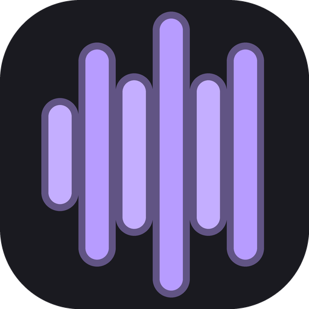
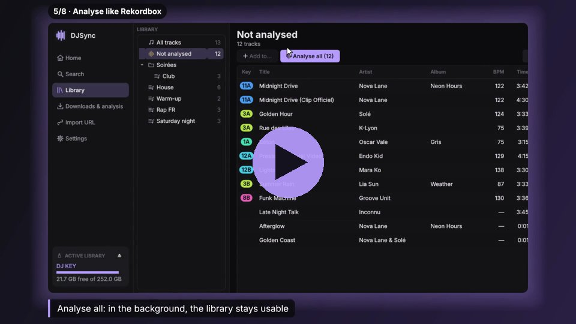
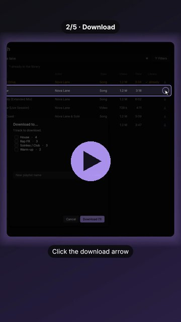
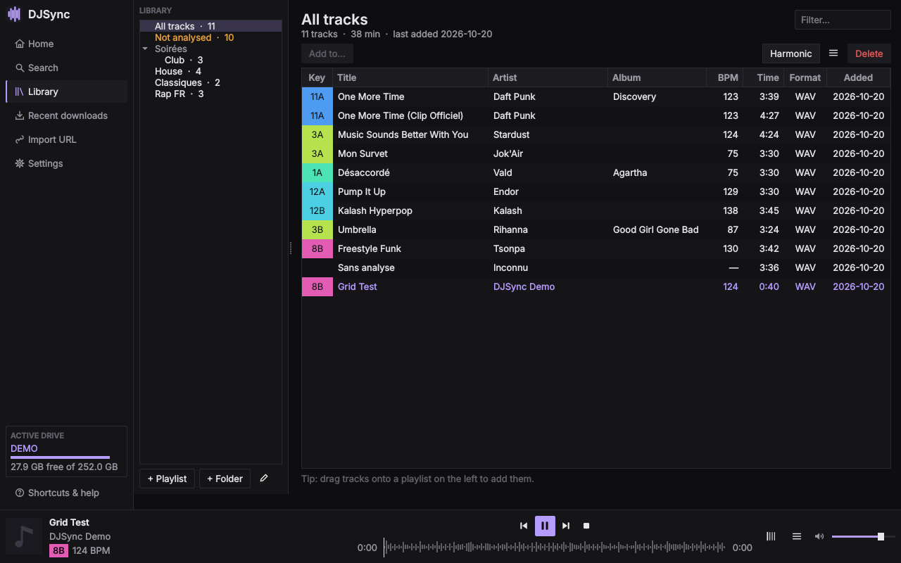
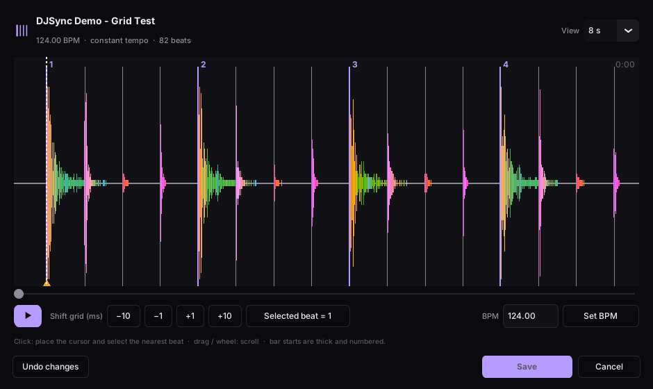

<p align="center">
  
</p>

<h1 align="center">DJSync</h1>

<p align="center">
  Find music, put it on your Rekordbox USB drive, ready for Pioneer CDJs — without going through Rekordbox.<br>
  One file on your USB drive, any computer: Windows, macOS, Linux.
</p>

<p align="center">
  
  
  
  
</p>

<p align="center">
  🙏 <b>Thanks / Merci</b><br>
  A huge thank you to Tazyh, Vogue, Paf and Kuss for sharing their resources and testing, and for helping make this project happen.<br>
  <i>Un grand merci à Tazyh, Vogue, Paf et Kuss pour la mise à disposition de leurs ressources, leurs tests et leur aide pour mener ce projet à bien.</i>
</p>

---

## What DJSync does

DJSync is a **portable** desktop app — it runs straight from the USB drive, on any Windows, macOS or
Linux computer, nothing to install — that works on a drive exported by Rekordbox:

- **Search and download** from YouTube Music (results as you type, preview before downloading), or
  **import a link** from Spotify, YouTube or SoundCloud (single track or playlist).
- **Write directly into the drive's library**: `exportLibrary.db` (OneLibrary, recent players) **and**
  `export.pdb` (older players), with date added and artwork.
- **Analyse tracks** without Rekordbox: BPM, beat grid, key (shown in Camelot notation), Pioneer waveforms
  (ANLZ files), in the background (Library ▸ *Not analysed*). Tracks already analysed by Rekordbox are never
  changed.
- **Manage the library** like a mini Rekordbox: playlists and folders, drag and drop, track order,
  harmonic filter, built-in player with waveform.
- **Fix** a shifted beat grid (also straight from the player) and **set hot cues, loops and memories**
  (pads A–H in the Rekordbox colours, 1–16 beat loops, names), without Rekordbox.
- **Find and merge duplicates**, decided by comparing the audio (not only the title), with the hot cues of
  the version you choose carried over to the one you keep.
- **Clean up track info** (title, artists, album, year, genre, artwork) with suggestions from Deezer, reviewed
  track by track on a before / after view.
- **Update the Rekordbox collection of this computer** too (Rekordbox 6/7, `master.db`): same features as
  for a USB drive — download into the collection, playlists and folders, analysis, beat grid, title/artist,
  duplicates. DJSync only writes while Rekordbox is closed.
- **Copy playlists between libraries** (USB drive ↔ this computer, drive ↔ drive) with their analysis,
  **complete missing metadata** of existing tracks, add a **memory cue on the first downbeat**.
- **Backups and one-click restore**: the drive's original library (before DJSync) is kept forever, plus
  manual backups and yearly / monthly / weekly / recent ones (`DJSync_Backups/` on the drive). DJSync can
  also **remove itself from the drive** (Settings ▸ Drive backups).
- **Eject** the drive safely from DJSync.

English interface (French available in Settings; other languages can be added — see below), 20 colour
themes, zoom from 80 to 200 %. Fast Qt interface (PySide6), no animations.

> ⚠️ Personal project, not affiliated with Pioneer DJ / AlphaTheta. The drive formats are reverse-engineered:
> **keep a copy of your drive** and close Rekordbox while DJSync writes to it.

## Videos

| Full tour — every menu (3 min, 1080p) | Short — the main workflow (1 min 30, vertical) |
|---|---|
| [](https://github.com/user-attachments/assets/202ed7d1-8311-40cf-93b4-9a8f64c88e1d) | [](https://github.com/user-attachments/assets/7ceb08e1-6a5e-4979-b6a6-39328b6b4e94) |

Click a picture to play the video. Demo library with made-up artists; regenerate them with
`python tools/tour_video.py tour.mp4` and `python tools/teaser_video.py short.mp4`.

## Screenshots

| Library | Beat grid editor |
|---|---|
|  |  |

## Download

| Your computer | Download |
|---|---|
| **Windows** 10 / 11 | ⬇ [**DJSync.exe**](https://github.com/Pikkol0/djsync/releases/latest/download/DJSync.exe) — one file |
| **macOS** 11+ (Apple silicon) — *beta* | ⬇ [**DJSync-macOS.dmg**](https://github.com/Pikkol0/djsync/releases/latest/download/DJSync-macOS.dmg) — drag DJSync onto your drive |
| **Linux** x86-64 — *beta* | ⬇ [**DJSync-Linux-x86_64.tar.gz**](https://github.com/Pikkol0/djsync/releases/latest/download/DJSync-Linux-x86_64.tar.gz) — DJSync folder |

Put it on your USB drive and open it: nothing to install on the computer, FFmpeg and the JavaScript
runtime needed for YouTube are included, settings stay on the drive. DJSync tells you when a new
version is out.

> **How light is it?** Rekordbox needs **2 GB** free on your computer to install. DJSync fits **on your
> USB drive in ~250 MB** (~300 MB with its backups) — less than 25 tracks in MP3 320 — and runs on any
> computer you plug the drive into.

Step by step: **[quick installation guide](docs/INSTALL.md)** ([français](docs/INSTALL.fr.md)) ·
pre-releases and older versions: [all releases](https://github.com/Pikkol0/djsync/releases).

## Help test DJSync (beta)

Testers wanted — especially **with real players** (CDJ / XDJ, not a controller). Download the latest
[pre-release](https://github.com/Pikkol0/djsync/releases), follow the **[tester guide](docs/TESTING.md)**
([français](docs/TESTING.fr.md)) and send a
[test report](https://github.com/Pikkol0/djsync/issues/new?template=deck_test.yml) or a
[bug report](https://github.com/Pikkol0/djsync/issues/new?template=bug.yml) with the log file.

## Run from source

### Requirements
- **Python 3.10+** (developed and tested with 3.12)
- **FFmpeg** (`ffmpeg`): download, m4a playback, analysis. In the `PATH`, or the folder set in
  *Settings ▸ FFmpeg*.
- A **JavaScript runtime** for YouTube downloads (yt-dlp): Deno, Node.js or
  [QuickJS-NG](https://github.com/quickjs-ng/quickjs) (`qjs`, 2.5 MB — the one shipped with the builds).

### Steps
```bash
git clone https://github.com/Pikkol0/djsync.git
cd djsync
python -m venv .venv
.venv\Scripts\activate          # Windows   (Linux/macOS: source .venv/bin/activate)
pip install -r requirements.txt
python app.py
```
### Building the executables
The **Build** GitHub workflow (`.github/workflows/windows.yml`, run it from the *Actions* tab or by
pushing a `v*` tag) builds Windows, macOS and Linux. **macOS**: `DJSync.app` (Apple silicon), ad-hoc
signed, in a `.dmg` (dmgbuild: background telling to drag it onto the USB drive). Not signed by Apple: the
first launch needs *Open Anyway* once; DJSync then lifts the quarantine of its copy on the drive and
relaunches from it (`portable.leave_translocation`). **Linux**: the `DJSync` folder (built on Ubuntu 22.04 for an old glibc), tar.gz. Both
ship an audio-only FFmpeg (`TARGET=native packaging/build_ffmpeg.sh`) and QuickJS, and are self-tested.
**Windows**: a **single `DJSync.exe`**: a 150 KB launcher (`packaging/launcher`, C +
miniz) with the application folder zipped behind it. On first launch (or after an update, or if the
folder was deleted) it extracts the application into the hidden `.djsync/app` next to itself, keeps
`.djsync/data` (settings), then starts it — later launches are instant. Unlike a PyInstaller one-file
exe, nothing is unpacked to the computer at every launch. The workflow tests the result like a user would
(DJSync.exe alone in an empty folder, self-test of the application). Optional code signing with the
`SIGN_CERT_PFX` / `SIGN_CERT_PASSWORD` secrets. By hand:
```bash
pip install pyinstaller
pyinstaller packaging/DJSync.spec              # -> dist/DJSync/ (DJSync.exe + _internal)
packaging/build_ffmpeg.sh out/                  # (Linux, mingw-w64) -> ffmpeg.exe, ffprobe.exe -> dist/DJSync/tools/
packaging/build_launcher.sh out/                # (Linux, mingw-w64) -> launcher.exe
python packaging/pack_single_exe.py out/launcher.exe dist/DJSync 1.0.0 DJSync.exe
```

### Download engine updates
yt-dlp is **never updated on its own**. When a download or a link import fails in a way that looks like
"YouTube changed", DJSync offers once to install the new version (official wheel from PyPI, SHA-256
checked, installed in the settings folder — the exe is not modified, no restart needed, failed downloads
are retried). *Settings ▸ Download engine* checks / installs by hand and goes back to the previous version.

## Quick use

| Shortcut | Action |
|---|---|
| `Ctrl+K` | Search a track or paste a link, from anywhere |
| `Ctrl+1` … `Ctrl+6` | Home, Search, Library, Downloads, Import URL, Settings |
| `Ctrl+F` | Search / filter field of the page |
| `Space` | Play / pause |
| `Ctrl+→` / `Ctrl+←` | Next / previous track |
| `F1` | Help |

The in-app **Shortcuts & help** button has a short guide.

## Command-line tools (read-only)
```bash
python -m djsync.db.diagnose E:            # check a drive's database
python -m djsync.db.pdb.check E:           # check export.pdb
python -m djsync.analysis track.m4a        # analyse a file (BPM, key, grid) without writing anything
python -m djsync.analysis --compare E:     # compare DJSync's analysis with Rekordbox's on a drive
```

## Languages
Everything (interface, error messages, logs, command-line output) is written in **English**. Other languages
only translate the interface: `djsync/i18n/fr.py` is a dictionary `key -> text`; **a missing key simply falls
back to English**, so a translation can be partial. To add a language, copy `fr.py`, translate what you want
and register it in `djsync/i18n/__init__.py`.

## Code layout

```
app.py                  entry point (python app.py)
djsync/
  core/                 YouTube Music search, download (yt-dlp), Spotify import, duplicates, Camelot
  db/                   USB drive: exportLibrary.db (SQLCipher) in library/, export.pdb in pdb/, artwork
  analysis/             BPM, grid, key, waveforms, ANLZ files (numpy + FFmpeg only)
  audio/                built-in player, artwork
  ui/                   Qt interface (PySide6): app, controller (ctrl/), views (views/), table, dialogs
  i18n/                 English (en.py, reference) and French (fr.py) texts
tests/                  pytest tests (fake drive, synthetic tracks)
tools/                  development tools: screenshots, logo export
packaging/              PyInstaller spec + icon
docs/                   technical notes (in French for now)
```

## Tests

```bash
pip install pytest
python -m pytest -q                 # everything, UI included (Qt "offscreen": no display needed)
```
Tests use neither the network nor a real drive: generated Rekordbox database, synthetic tracks.
A test also checks that no French text is hard-coded outside the translation file.
Screenshot tool (no display needed): `python tools/ui_screenshots.py shots --sizes 860x560,1280x800 --lang en --dialogs`.

## Technical notes (French)
- [Audio analysis, artwork, date added](docs/analyse_audio.md) — calibration on a real drive
- [Comparing DJSync's analysis with Rekordbox's](docs/comparaison_rekordbox.md) — procedure and sample size
- [export.pdb (older players)](docs/export_pdb.md)
- [V0.2.0 interface, beat grid, duplicates](docs/interface_v020.md)

## Version history

| Version | Changes |
|---|---|
| **1.3.1** | **Stable** (known issue: *Space used* does not work yet for the computer library, it does for USB drives; fixed in 1.4.0). **Library columns**: every metadata column can be shown (genre, year, label, bitrate, sample rate, rating, colour, plays, created, size, comment, location) from the *Columns* button; checked columns stay visible (the table scrolls sideways instead of hiding them), and their order, widths and choice are remembered. **Genre and label in export.pdb**: Rekordbox and older players show the genre of tracks added by DJSync (drives written before are caught up). **Settings side panel**: General · Libraries · Download · Analysis · Feedback and privacy · DJSync, a search field across all settings, last section remembered. **Space used** (Settings ▸ Libraries, or click the free space on Home): music, analyses and artwork, Rekordbox databases, DJSync backups, application, caches; empty the caches, keep only the latest restore points (the original state is never removed). **Diagnostic in tabs**: *Missing files* (replace with an identical track of the library, relink a moved file, download a clean version or remove the entry; tracks on a disconnected drive are flagged), *Duplicates* (format, bitrate and sample rate of every version, best quality marked and proposed, clean version to download), *Poor quality*, *Uniformise*; the missing-file message links to it. **Suggestions**: tracks that mix well after the playing or selected one (compatible key, close BPM, half and double tempo), to listen, add to the open playlist or drag onto a playlist; the *Harmonic* filter gains a BPM range. Player controls centred in the window, one *Filters* button in Search showing the active filters, a shared colour scale (good, fair, warning, problem) independent of the accent colour. **Also**: memory loops in the *Beat grid and cues* page (*Memory loop* button, or right-click a memory ▸ 1–16 beats), written like Rekordbox; thanks to the people who helped, at the top of this page, in Settings ▸ DJSync and in Feedback; an error that looks like a file held by Rekordbox ends with advice to close it, and error messages are wider, selectable, can be copied and stay until closed; DJSync.exe leaves out Qt files it never uses (software OpenGL, QML, virtual keyboard, other languages' Qt texts), for a smaller download and a faster first launch from a USB stick. **Settings tidied up**: an *Advanced* section for the rarely needed settings (FFmpeg, download engine, export.pdb, drive letter, audio delay), folded while all is well; a *Check everything* button (DJSync and engine versions, FFmpeg, drives, export.pdb brought up to date, Diagnostic), nothing installed without a click; *Uninstall DJSync* always in Settings ▸ DJSync, also when DJSync runs from the computer (program, settings, caches and log removed; music, Rekordbox libraries and, unless asked, master.db backups kept). **rc.2**: the *Suggestions* panel no longer crashes on Mac when changing tracks quickly; a native crash now leaves its trace in the log (sent with Feedback); dragging a column border in the Library resizes that column (the Title no longer absorbs it) and a thin line marks each border; *active loops* (a memory loop that engages by itself when playback reaches it, one per track) written to the analysis files and to master.db; duplicates show the real quality of a version to download first (« ≈ 128 kbps (YouTube Music) · saved as MP3 320 »); *Space used* on the computer counts the whole Rekordbox collection, its analysis folder and master.db. |
| **1.3.0** | **Stable**: on macOS in full screen, opening *Duplicates* or the *Diagnostic* no longer shows the desktop (the key badge of each version briefly opened as a window of its own before being placed in the page); on macOS, confirmation and *Download to…* windows no longer slide in as sheets, which held the sound for 120–170 ms (short gap while listening); deleting a pad whose loop is playing, or removing its loop, exits the loop at once (resizing it makes the playing loop follow); a test now opens every page and fails if any window flashes. **rc.9**: macOS diagnostics: for 3 s after a page opens, the log records every other window that appears and disappears (with timings), and when DJSync loses focus or leaves full screen, to find what sends a full-screen DJSync back to the desktop; late audio is no longer reported after the sound card was stopped (false delays of several minutes) and the log gives the worst delay; tracks without an audio fingerprint are counted instead of logged one by one. **rc.8**: *Back* from *Beat grid and cues* returns to the page you came from (Duplicates, Diagnostic, Analyse), as you left it; tracks re-analysed from the Library show in the *Analysis* list while they are analysed; Play / Pause no longer restarts the *Beat grid and cues* track when that page was left open behind another tab; on macOS the log now records an extra window opened with a page and late audio, to track two Mac-only issues; code of conduct, contributing guide, security policy and pull request template. **rc.7**: one *Duplicates* tool — the Diagnostic no longer has its own duplicates list, its *Duplicates* line opens the tool, which can now also replace every version with a clean download; a jump while playing (click on the waveform, hot cue, player bar) is heard at once — the playing track is kept decoded in memory (up to 12 min) and the sound card is no longer reopened (Windows, Linux); a drive unplugged and plugged back in before DJSync noticed is reopened by itself with one message, instead of "disk I/O error" and an error report. **rc.6, players**: analysis files of the tracks added by DJSync now go in the same folders as Rekordbox's (`PIONEER/USBANLZ/…` named from the track's path, like Rekordbox; `ANLZ0001` when two tracks share a folder); drives written by an earlier version are tidied up when opened (files copied, both databases updated, old files removed once export.pdb is up to date; Rekordbox's own tracks are never touched); export.pdb track rows written by DJSync now carry the same values as Rekordbox's (per-track id field, constant fields, no bit rate for m4a, duration truncated); faster releases (tests run next to the builds, FFmpeg and Python packages cached). **rc.5**: one *Duplicates* tool (the Diagnostic opens it to merge): groups listed at once, audio checked group by group afterwards (cached), parts and versions (*Pt. 3* / *Pt. 7*, remix, live…) no longer grouped, *Not a duplicate* takes one track out and is remembered (*Set aside* list to undo, *Full detection*); *Rekordbox open* only shown when Rekordbox itself is running; waveforms now look like Rekordbox's (height follows the real level instead of being stretched to the top, colours and previews recalibrated on tracks analysed by both, drawn 6.7 ms later like Rekordbox; re-analyse to update); sound no longer late on Windows: the sound card now keeps ~80 ms ahead instead of ~600 ms, the real delay is measured to place the cursors, and a jump (click on the waveform, hot cue, player bar) is heard at once (macOS unchanged; set *Extra audio delay* back to 0 unless you use Bluetooth headphones). **rc.4**: *Clean up track info* no longer squeezes and stretches the tracks while results arrive; with the *Beat grid and cues* page open, the play button of the bottom player (and Space, media keys) plays that page's track from its cursor; pause cuts the sound at once (the sound card's buffer, up to ~1 s with Bluetooth headphones, is dropped) and resumes from what was heard; *Test…* next to the audio delay setting (Settings ▸ Appearance) plays a click at 120 BPM to set the delay by ear, now up to 2 s; on Windows the DJSync splash with its exact version takes over from the executable's one before Qt starts, so it stays centred at 150–200 % display scaling; a new accent colour is applied everywhere at once (Home tools included), without restarting; a drive pulled out without eject gives one clear message, also when it is noticed by the drive watch, and no follow-up error. **rc.3**: the version is shown while DJSync starts (native splash on Windows, splash on macOS/Linux, where the logo is no longer drawn twice too big); the Windows launcher window says *Setting up DJSync x.y.z on this drive* or *Updating DJSync A → B*, in the Windows language only, sized for 125–200 % display scaling, with a percentage; downloaded tracks are analysed in the background by default, with one setting for the USB drive and one for the computer library (Settings ▸ Analysis); when export.pdb is not up to date, the drive card on Home says what is missing and offers *Update export.pdb*; *Beat grid and cues* page: pads and labels sized for 125–200 % display scaling, bar numbers and cue letters on separate rows, the player shows the whole track in 3 bands (click or drag to move through it), optional *Fixed cursor in the middle* (remembered); the playback cursor follows what you actually hear (smooth, no longer ~0.2 s ahead), with an extra delay setting for Bluetooth headphones; *Exit loop* button on the grid page (playback carries on, no cut); without the audio file the grid page shows Rekordbox's 3-band waveform; *Clean up track info* adds tracks without jumps and shows *Search differently* results as two-line cards; a drive pulled out without eject gives a clear message instead of "disk I/O error"; a missing audio file is reported for the library actually open (drive or computer), marked in the duplicates and on the grid page; export.pdb error messages in English. **rc.2, older players (export.pdb)**: a drive freshly prepared by Rekordbox no longer becomes "corrupted" for Rekordbox after DJSync adds tracks (index page of a new table, repaired by itself on drives written by rc.1); export.pdb is now reconciled with exportLibrary.db as a whole (order, removals, renames, deleted tracks, edited titles), so a write that failed (Rekordbox open on the drive, drive pulled out) is caught up at the next write, when the drive is opened, or on *Eject*, which warns if something is left. **Hot cues, loops and memories** in the *Beat grid and cues* page (right-click a track ▸ *Beat grid and cues…*): eight pads A–H in the Rekordbox colours under the waveform; an empty pad sets a cue on the nearest beat (Shift: exactly at the cursor), a set pad plays from it; right-click for a 1–16 beat loop, a name, 16 colours, move or delete; drag a cue's letter on the waveform; memories at the cursor; *Suggest cues* fills the free pads only. Nothing is written before *Save*; written like Rekordbox (ANLZ files on the drive, `djmdCue` on the computer), originals backed up. **Clean up track info** (Uniformise v2, Home tile): each track on two lines, *Now* and *After*; click a field to edit it, colour shows what changes and what is uncertain; artwork removed on hover, uploaded or dropped; tracks one after the other, Enter validates and the next one comes; *Search differently* for a wrong title; better Deezer search (YouTube ids removed, featured artists used, several queries). **Duplicates by the audio**: versions found by the title are compared by their sound (same track, variant with a part in common, or different and taken out of the group). **Hot cues carried over**: when merging duplicates, choose whose hot cues to keep; they are lined up on the kept version by the audio offset, also after a replacement from the Diagnostic. |
| **1.2.4** | **Older players (export.pdb)**: drives exported by Rekordbox 7 and older exports with big playlist pages are no longer refused ("next free page outside the file", "inconsistent counters"): DJSync updates their export.pdb again and catches up what was missing when the drive is opened. A file stored several times in an old export, or two playlists whose names differ only by upper/lower case, no longer lead to tracks added twice to a playlist. A drive that Rekordbox has not prepared yet now appears on Home with what to do, instead of not showing at all. |
| **1.2.3** | **Send my logs** (Feedback tab): the log with personal paths hidden, a report on the drive (file system, PIONEER/rekordbox files, export.pdb check) and, if ticked, the drive's library files zipped — for tests and problems on the decks. **Error reports**: after an unexpected error, DJSync offers to send a report to the author (setting: ask each time, always, never). **Drive format**: the Home card shows the file system and warns when older players cannot read it (exFAT/NTFS: *NO USB / E-8307* on an XDJ-1000), and when export.pdb is missing or not up to date. **Mac feedback**: one click on a playlist name ticks it in *Download to…*, no more audio "rollback" when a window opens, macOS media keys and Now Playing, Duplicates / Diagnostic / Analyse open as pages of the main window, scrolling waveform with a centred playhead in the player (like Rekordbox). Developer: `python -m djsync.db.pdb.compare` compares two export.pdb files. |
| **1.2.2** | **Edit info** (right-click a track, the player or Tools): title, artists, album, year, genre and artwork (keep, pick one found on Deezer, an image from the computer, or none) — the audio file is never touched. **Uniformise** a playlist or the whole library: clean titles (no *feat.*, no *Official Video*), artists separated by commas with guests taken from the title, album / year / genre / artwork filled in when empty; a review page where nothing is written until you validate track by track and *Save*, progress kept between sessions, suggestions unticked for tracks not downloaded by DJSync. **Playlists by genre** (off by default): a *DJSync ▸ Genres* folder, one playlist per genre or group of genres, kept up to date as you download or edit, even once moved or renamed; tracks you add yourself are never removed. Developer: voice-over and subtitles for the tour video (`tools/narrate.py`), French tour (`--lang fr`). |
| **1.2.1** | **Feedback tab**: report bugs, ideas and comments from the app, several remarks per sending, each with its type, text and up to 3 screenshots (capture of the DJSync window, image picked or dropped), technical details and the end of the log without personal paths if wanted; sent by e-mail through a small Google Apps Script of the author (`tools/feedback/`, setup in `docs/FEEDBACK_SETUP.fr.md`), otherwise a pre-filled GitHub issue. **Library**: choose the columns shown (right-click a header), widths and the sort of each playlist remembered, `#` wide enough for 700+ tracks, new **Source** column (YouTube Music, YouTube, SoundCloud…). **Playlist picker** as a folder tree with search, new playlists created in the selected folder. **Search**: Everything / Title / Artist / Album selector (an artist's tracks, not tracks named after them), albums opened in one double-click with all their tracks ready to download, maximum duration and "hide tracks already owned" filters. Grid editor zoom (Ctrl/⌘ + wheel, pinch, − / +). Duplicates: playlists of each version, *Start* / *Middle* listening. Progress bars in each download row, overall download progress, estimated progress of the track being analysed, one *Activity* card in the sidebar. |
| 1.2.0 | **macOS (Apple silicon, .dmg) and Linux builds** (beta), built and self-tested by the *Build* workflow next to Windows; on macOS, the first launch lifts the quarantine by itself and relaunches from the drive. DJSync tells you when a new version is out (Settings, once a day; test versions also see pre-releases). Grid backups and the grid waveform cache are capped. GPL-3.0 license, tester guide (computer, Rekordbox, players) and issue forms. Presentation videos (`tools/tour_video.py`, `tools/teaser_video.py`). rc.3: drive restore points (Settings ▸ Drive backups), remove DJSync from a drive, clearer computer-library errors. **rc.4**: **update DJSync from the app** (Settings ▸ DJSync: download, SHA-256 check, restart into the new version; stable or test channel), exact version shown everywhere (a test build now sees the next test build); **m4a beat grids no longer early in Rekordbox** (measured −32.5 ms on 52 tracks, now compensated: re-analyse m4a tracks, *Tools* ▸ *Analyse selection* ▸ *Re-analyse*), ½-beat button in the grid editor, half-beat count in `--compare`; Rekordbox saving master.db in place is picked up before DJSync writes; click-to-seek bar, spinner while a track loads, Space after *Listen* and keyboard media keys; collapse/expand button for the sidebar; playlist picker with search and full-height list; dialogs stay above the window on macOS (full screen too); French fixes; About (license, third-party components, credits). |
| 1.1.0 | **Library diagnostic** (Home ▸ *Diagnostic*, one button per library: USB drive and computer): duplicates, low-quality files (MP3 < 192 kbps, AAC < 112 kbps, < 44.1 kHz) and bad sources (music video, live, lyrics, visualizer, sped up…). For each problem: keep one of the versions, or **download a clean version** (YouTube Music, SoundCloud as a fallback) that replaces the old one(s) in all their playlists, at the same position, and is analysed again; *Ignore* is remembered. Beat grid editor: no more old waveform for 2 s, the Rekordbox-style waveform is cached (instant on reopening). `python -m djsync.analysis --compare` also reads this computer's Rekordbox collection (`--compare local --under E:\Contents`), ignores tracks analysed by DJSync itself and gives 95 % confidence intervals ([procedure](docs/comparaison_rekordbox.md)). Presentation video tool (`tools/demo_video.py`). |
| 1.0.0 | First release: ONE file to download, DJSync.exe (prepares itself on first launch, repairs itself if moved or deleted, keeps settings across updates), published as a GitHub release with its SHA-256 and notes built from this table. Everything from 0.1 to 0.5: search and download from YouTube Music, Spotify/YouTube/SoundCloud import, USB drives (exportLibrary.db + export.pdb) and the Rekordbox library of the computer, BPM/key/grid/waveform analysis, beat grid editor, duplicates, playlist copy between libraries, metadata completion, memory cue, eject, yt-dlp updates on demand. |
| 0.5.1 | Windows CI: full test suite passes on Windows (280 tests); failing tests are reported as annotations on the run page; GitHub actions moved to Node 24. |
| 0.5.0 | Portable build that looks like a single file (DJSync.exe + hidden `.djsync` folder), audio-only FFmpeg and QuickJS instead of full FFmpeg + Deno (≈ 250 MB less), GitHub workflow for the Windows build with optional signing. Player on miniaudio instead of pygame (streams, nothing decoded in full). yt-dlp updated only on failure or by hand (Settings ▸ Download engine), with rollback. Eject button; when running from a USB drive, the host computer's Rekordbox library is opened only after asking (remembered per computer). Copy a playlist to another library (USB ↔ computer, drive ↔ drive) with its analysis reused, not recomputed. Complete missing metadata (Deezer) of existing tracks. Memory cue on the first downbeat (ANLZ + database). Download format M4A (original) or MP3 320, optional loudness normalisation. Analysis memory peak reduced (≈ -30 % on a long mix, same results). |
| 0.4.0 | Rekordbox library of this computer (`master.db`, Rekordbox 6/7): opened automatically when no drive is plugged in, or from Home / Settings. Downloads go to Music/DJSync (configurable) and into the collection with analysis (ANLZ files under `share`, named after the track UUID), artwork (640/240/80 px), album, genre, label, year; playlists and folders (masterPlaylists6.xml kept in sync), beat grid, title/artist, duplicates, delete. Never writes while Rekordbox is open; master.db copied before each change. Built on pyrekordbox. |
| 0.3.1 | Polished interface: icons on buttons, menus, tables and the sidebar, rounded cards, key pills, larger search fields, messages as small pop-ups; explanations moved to tooltips (ⓘ) and needless texts removed. New "Downloads & analysis" page: downloads table + analysis table (every unanalysed track, search in the whole library to re-analyse, beat grid editor icon on each analysed track). |
| 0.3.0 | New Qt interface (PySide6) replacing customtkinter: native widgets, much smoother scrolling, resizing and table updates. Zoom and theme colour apply instantly without rebuilding the window; the zoom no longer follows the window size. Plainer look: flat dark theme, square corners, no shadows or animations, no per-row artwork or placeholder rows. Beat grid editor: drag the listening cursor on the waveform, "Bar starts here" (a downbeat exactly on the cursor), shift by ±1/±10/±100 ms, BPM ×2 / ÷2. Rekordbox 3-band waveforms (`.2EX`): track previews now look like Rekordbox's own instead of blue (re-analyse older tracks). Downloads complete album, year, genre, label, track number and ISRC (Deezer, can be turned off). Same features as 0.2.4 otherwise; UI tests run without a display. |
| 0.2.4 | Background analysis: Library ▸ *Not analysed* section with "Analyse all" / "Stop", progress card in the sidebar, the rest of the app stays usable. Player: beat grid button and track options (title/artist, analyse again, compatible keys, show in library). export.pdb: track updates no longer eat the free space (in-place rewrite, deleted rows reclaimed), clearer "export.pdb is full" message. Beat grid editor is now a page of the main window (the separate window vanished or froze the app on Windows). Fixes: dialogs sized for the zoom and kept on screen, key pill now shown right after analysis. |
| 0.2.3 | Windows start-up fix: the main window stayed invisible after the splash screen, and the splash shrank to a corner (DPI awareness set too late). |
| 0.2.2 | Window always opens inside the screen (saved size/position clamped, maximised state remembered); lightweight splash screen at launch (also a native splash for the Windows executable). |
| 0.2.1 | Fully English software: error messages, logs and command-line tools included; French kept as an optional interface translation (partial translations fall back to English). English README, obsolete console demos removed. |
| 0.2.0 | New interface: Home + omnibar, search as you type, "All tracks", Camelot pills, drag and drop onto playlists, harmonic filter, player previous/next + waveform, zoom and small windows, English by default, logo per colour. On-demand analysis, beat grid editor, duplicates tool, help and shortcuts. Code split (library, controller). |
| 0.1.6 | Local BPM / key / ANLZ waveform analysis, date added and artwork in both databases, calibration on a real drive (MP3 encoder delay). |
| 0.1.x | YouTube Music search and download, Spotify/YouTube/SoundCloud import, writing to exportLibrary.db then export.pdb, library and playlists, player, portable mode. |

## Releasing
`djsync/__init__.py` holds the version. Add its row to the table above, then push a tag:
`git tag v1.0.0-rc.1 && git push origin v1.0.0-rc.1` publishes a **pre-release** to test on real hardware;
`git tag v1.0.0 && git push origin v1.0.0` publishes the release. The *Build* workflow refuses a tag
that does not match the version, runs the tests on Windows, macOS and Linux, builds the three downloads
and attaches them to the release.

## Roadmap
- [ ] Beta with testers, on real players (recent CDJ/XDJ reading OneLibrary, older ones reading export.pdb)
- [ ] Compare the analysis with Rekordbox on 300–500 varied tracks ([procedure](docs/comparaison_rekordbox.md))
- [ ] Signed executables (no Windows SmartScreen / macOS Gatekeeper warning)
- [ ] macOS on Intel Macs; Linux as a single AppImage file
- [ ] Public release

## Contributing

Bug reports, deck tests, ideas and pull requests are welcome: see [CONTRIBUTING.md](CONTRIBUTING.md)
(how to report, what never to attach, how to run the tests). Please follow the
[code of conduct](CODE_OF_CONDUCT.md); security problems go through [SECURITY.md](SECURITY.md).

## Credits
- [pyrekordbox](https://github.com/dylanljones/pyrekordbox) and the community documentation
  [Deep Symmetry / crate-digger](https://djl-analysis.deepsymmetry.org/) for the Rekordbox formats.
- [yt-dlp](https://github.com/yt-dlp/yt-dlp), [ytmusicapi](https://github.com/sigma67/ytmusicapi),
  [Qt for Python (PySide6)](https://doc.qt.io/qtforpython-6/), [SQLCipher](https://www.zetetic.net/sqlcipher/).

## License
DJSync is free software under the [GNU General Public License v3.0](LICENSE): you can use, study,
share and modify it; modified versions you distribute must stay under the GPL, with their source code.
Bundled components keep their own licenses: see [THIRD_PARTY_NOTICES.md](THIRD_PARTY_NOTICES.md).

Only download content you have the right to use.
